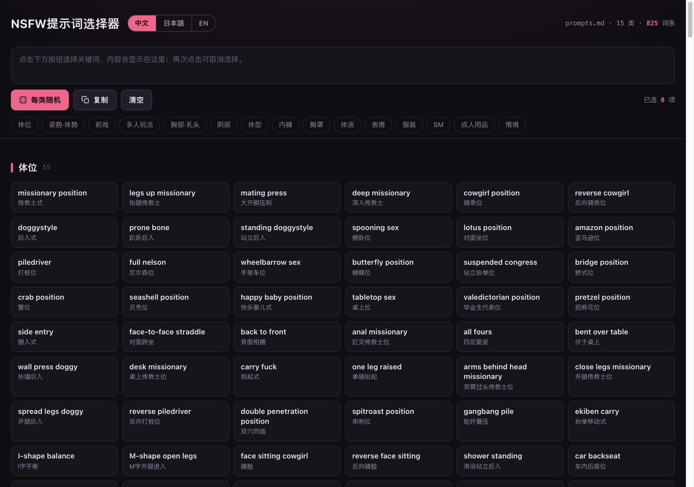

# NSFW Prompt Selector

A single-file, offline prompt builder for adult (NSFW) image generation. Browse 1,080 curated trilingual keywords across 27 categories, toggle them into a prompt that is auto-ordered like a real image-prompt template, roll one random keyword per category, keep a separate negative prompt, and copy the result to your clipboard — all from one HTML file with zero dependencies.

> ⚠️ **Explicit content — 18+ only.** This repository contains sexually explicit terminology. Do not view or use it if you are a minor or if such material is illegal in your jurisdiction.



## Features

- **1,080 keywords / 27 categories in 8 groups** — quality & technical, art style, character basics, hairstyles, eyes, body, clothing, positions, poses, foreplay, group play, SM, toys, expressions, emotions, environments, props, weather, lighting, color, camera work, and more
- **Template-ordered output** — categories follow the recommended prompt structure (quality/style → subject → action → scene → light & camera), so the composed prompt is ordered correctly no matter in which order you click
- **Priority badges** — categories taken from the classification supplement doc carry P0 (essential) / P1 (recommended) / P2 (nice-to-have) tags
- **Toggle to compose** — click a keyword to add it to the prompt box, click again to remove it; the side nav and every category header show live selection counts
- **Random** — roll one random keyword from *every* category at once
- **One-click presets** — ✨ Magazine cover, 🌸 Anime, 📷 Photo: each auto-ticks a proven combination (additive on top of your current selection)
- **Prompt output language** — Chinese / English / bilingual, independent of the UI language; your choice is remembered
- **Negative prompt panel** — collapsible, editable, prefilled with the usual quality negatives; persisted locally with its own copy button
- **Copy** — one click copies the composed prompt to the clipboard
- **Trilingual interface** — Chinese / Japanese / English category names and glossaries, switchable in the header
- **Zero dependencies** — one self-contained `index.html`; works offline, straight from a double-click
- **Responsive & accessible** — dark UI that scales from phones to ultrawide monitors; keyboard-operable with visible focus; honors `prefers-reduced-motion`

## Getting started

No build step and no server required:

1. Clone or download this repository
2. Open `index.html` in any modern browser
3. Pick keywords, hit **Random** if you feel lucky, then **Copy**

To put it online, enable GitHub Pages (*Settings → Pages → deploy from branch*) — `index.html` sits at the repo root, so it is served automatically.

## Repository layout

```
.
├── index.html    # the entire app: markup, styles, logic, and keyword data
├── prompts.md    # source keyword tables (English keyword + Japanese gloss per category)
└── docs/
    └── screenshot.png
```

## Modifying the data

The keyword data is compiled into `index.html` as a JSON array at the top of the `<script>` block:

```js
const DATA = [
  {
    name: "体位",            // original Japanese category name
    zh: "体位",              // Chinese category name
    en: "Sex Positions",     // English category name
    g: 4,                    // group id (nav separator + output ordering, see GROUPS)
    pri: "P0",               // optional priority tag from the supplement doc (P0/P1/P2)
    items: [
      ["missionary position", "正常位", "传教士式"],  // [keyword, Japanese, Chinese]
      ...
    ],
  },
  ...
];
```

Categories are stored in prompt-template order — `currentText()` walks `DATA` top to bottom, so the display order *is* the output order. Edit entries directly in `index.html` and reload — that's it.
